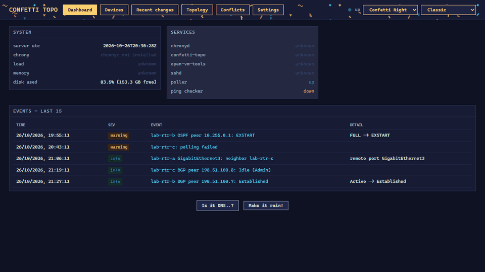
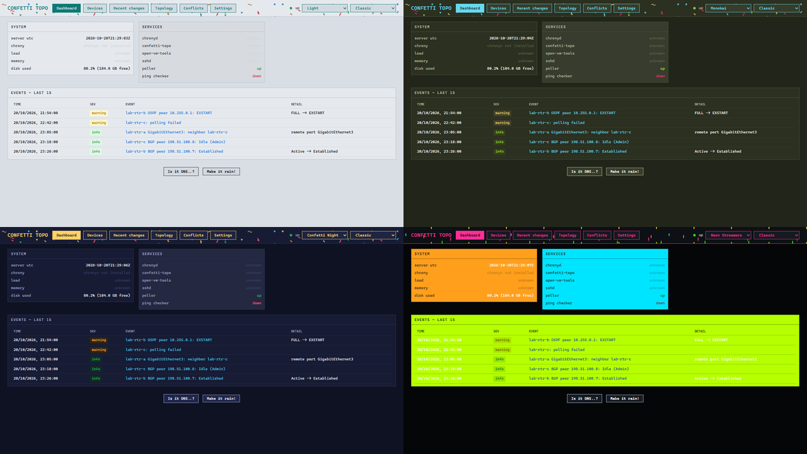
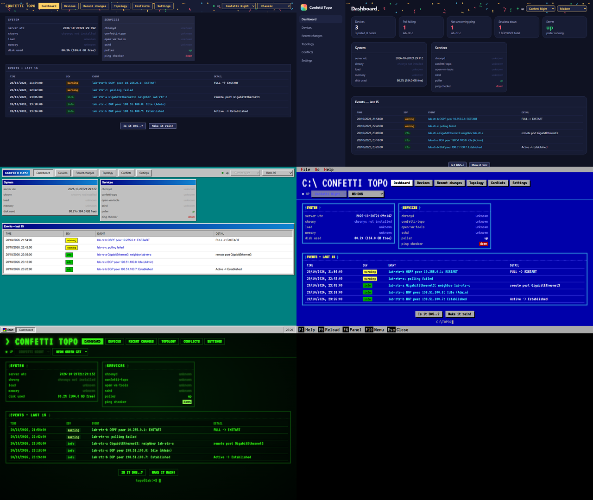

# confetti-topo

> **AI disclaimer:** This project was created using [Claude Code](https://claude.com/claude-code).

A small server that draws the network from what its routers say about themselves. It logs in to each
router over SSH (read-only `show` commands), reads LLDP neighbors, BGP sessions and OSPF adjacencies, and
shows them as one topology graph. confetti-topo never writes to a device.

It started as the topology part of [confetti-butler](https://github.com/orneh24/confetti-butler) and is its
own project now, with its own device list, poller and database. The look follows the hub UI of the sibling
project [confetti-traffic](https://github.com/orneh24/confetti-traffic).



*Mock data from a made-up lab, using documentation-range addresses. See [Running locally](#running-locally).*

## What it does

- **Topology.** LLDP cables, BGP sessions and OSPF adjacencies on one graph, with per-protocol toggles and one to hide unknown (ghost) nodes, remembered in the browser.
  Devices are drawn as icons by type (router, switch, firewall, Linux server) with a Cisco, Palo Alto, Juniper or HPE mark; both can be switched off.
  A cable or session that both routers report is drawn once. A neighbor that is not a known device shows
  as a dashed "ghost" node, so nothing is silently dropped. A BGP/OSPF session that is not Established /
  FULL is red and dashed. Unknown nodes that hang off one router are grouped into a single "N unknown"
  node (double-click to open it). The layout stands still and is saved on the server, so everyone sees the
  same map (right-click the background and choose Re-arrange to start over). An LLDP link shows its ports
  on hover or when selected.
- **Peers find their router.** A BGP or OSPF peer is usually a loopback or link address, not the router's
  management IP. confetti-topo also reads each router's interface addresses, so a peer resolves to its
  router when exactly one router owns that address. Peers outside your lab stay ghosts.
- **Devices.** Add routers by hand, by a subnet sweep (SSH port scan), from a YAML seed file, or import the
  test nodes from confetti-traffic or the device list from confetti-butler. The same router seen by two sources lands on one device. When the
  identifiers disagree (the same IP now answers with a different serial), it raises a conflict instead of
  guessing.
- **Polling.** Every few minutes it logs in once per router and reads version, interfaces, LLDP, BGP and
  OSPF. Anything a router stops reporting drops out. A failed poll (timeout, bad login) removes nothing.
  Platforms: Cisco IOS / IOS-XE.
- **Crawl.** LLDP neighbors that advertise an unknown management IP are listed on the Devices page and can be
  added as inventory-only devices (polling stays off until you set a login and enable them).
- **Reachability.** Every device is pinged every 30 seconds; a router that stops answering is outlined red
  on the graph.
- **Events.** Neighbor, peer and interface changes, OS changes and devices going unreachable are listed on the
  dashboard, on each device page and on the Recent changes page. There is no alerting; see the roadmap.
- **Metrics.** `GET /metrics` serves Prometheus text.
- **Look.** Seven colour themes (or Shuffle) and five layouts, picked in the header.





The MS-DOS layout can be driven from the keyboard: F10 or Alt for the menu bar, Up/Down and Enter on table
rows, F6 between panels, F1 for the list.

Built for Cisco IOS / IOS-XE. The parsers come from confetti-butler, where they were checked against CSR1000v
routers on IOS-XE 17.3 and 15.4; confetti-topo itself has not been run on real routers yet (see
[`docs/HANDOFF.md`](docs/HANDOFF.md)).

## Running locally

Needs Python 3 and `pip install -r topo/requirements.txt`. Port 80 needs admin rights, so pick another:

```sh
cd topo
TOPO_PORT=8080 python serve.py
```

Open http://localhost:8080 and add a device on the Devices page. Set the SSH login for all devices on the
Settings page (or for one device on its page, under Credentials), then click **Poll now** (Devices page or device page) or **Poll all now**. The database is `topo.db` in the working folder.

To look around without a router, fill a new database with a fake lab:

```sh
python scripts/seed_mock_lab.py mock.db
TOPO_DB_PATH=mock.db TOPO_PORT=8080 TOPO_PING_ENABLED=false python serve.py
```

## Deploying

`topo/build-template.sh` builds an Alpine Linux VM template (OpenRC service, waitress, port 80), following the
same pattern as confetti-traffic's hub and confetti-butler. **It has not been run yet**; it is a copy of
butler's script, which has run on a real Alpine 3.24 VM.

- **Update a running VM:** `topo-update.sh` (no arguments: downloads the latest build from GitHub; a `<topo-dir|tarball>` argument updates from that instead and asks first without `-y`) installs the new code and packages
  (`build-template.sh --update`), checks it, backs up the database,
  swaps it in, and rolls back by itself if it does not come up. `--rollback` goes back one version.
- **Backups:** nightly (7 kept) to `/var/lib/confetti-topo/backups`.
- **Clone settings:** `guestinfo.topo.ip` / `gateway` set a static IP; `ssh_username`, `ssh_password`,
  `ssh_secret` and `poll_interval_s` set the polling defaults.
- **Container:** `container/` has a Dockerfile and compose file for trying it without ESXi:
  `docker compose -f container/docker-compose.yml up --build`. For development,
  `container/docker-compose.dev.yml` mounts `topo/` live: `--profile mock` (fake lab, port 8080) or
  `--profile lab` (empty DB for real routers, port 8081).

## Security notes

- Credentials are stored in plain text in `topo.db`. Keep the file private; it is gitignored.
- The web UI and API have no login. Run it on a lab network only. A sweep range or a confetti-traffic or confetti-butler URL
  given to the API makes the server connect there.

## More

- [`CLAUDE.md`](CLAUDE.md): architecture and the rules not to break
- [`docs/TOPOLOGY-MAPPING.md`](docs/TOPOLOGY-MAPPING.md): how the mapping works, pitfalls, a test checklist
- [`docs/HANDOFF.md`](docs/HANDOFF.md): build history, and what is and isn't verified
- [`docs/ROADMAP.md`](docs/ROADMAP.md): what could come next
