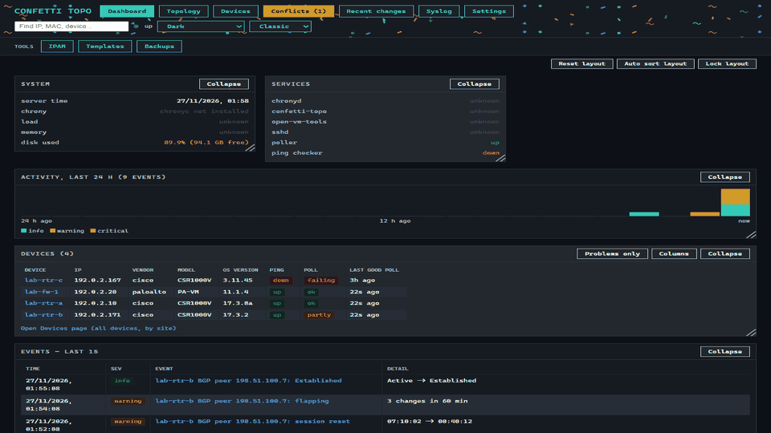
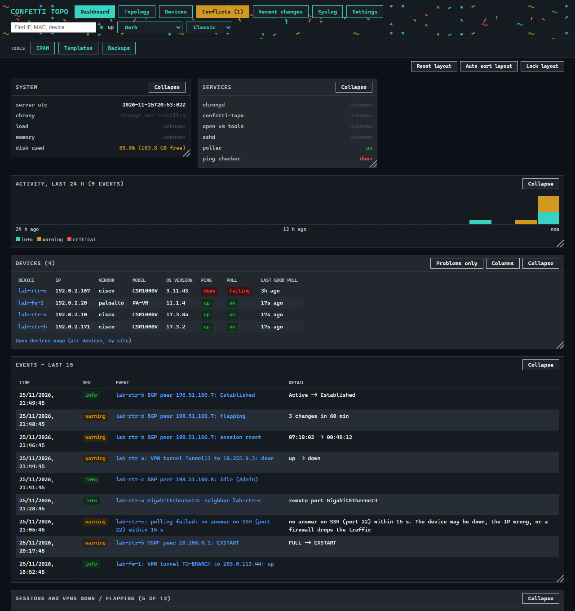
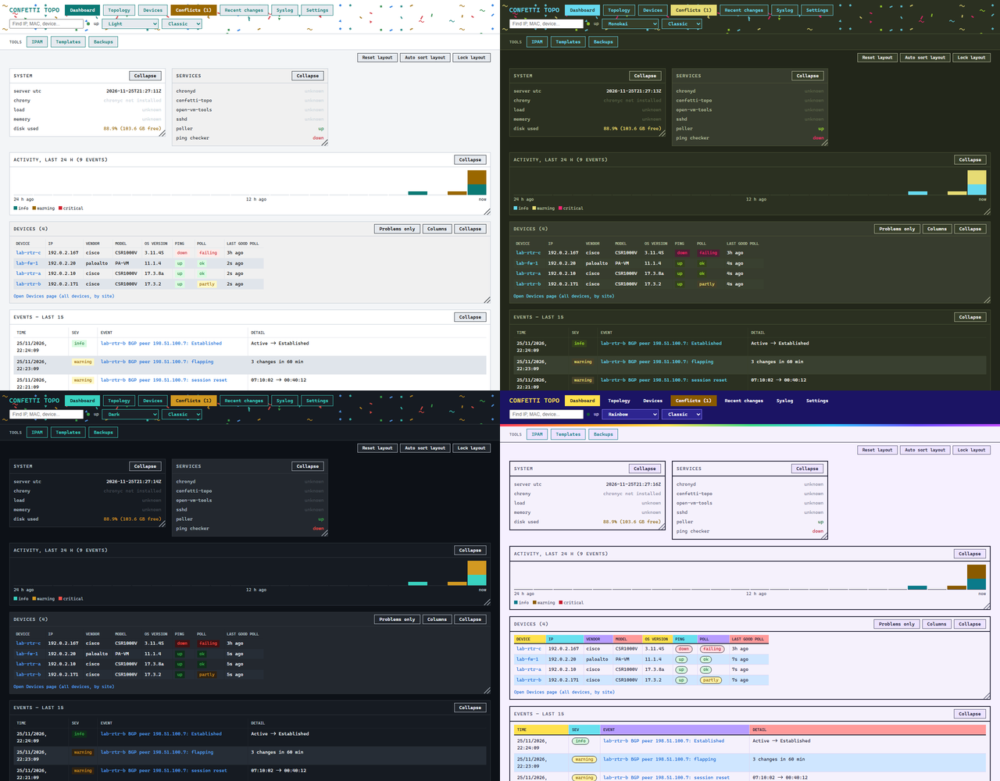
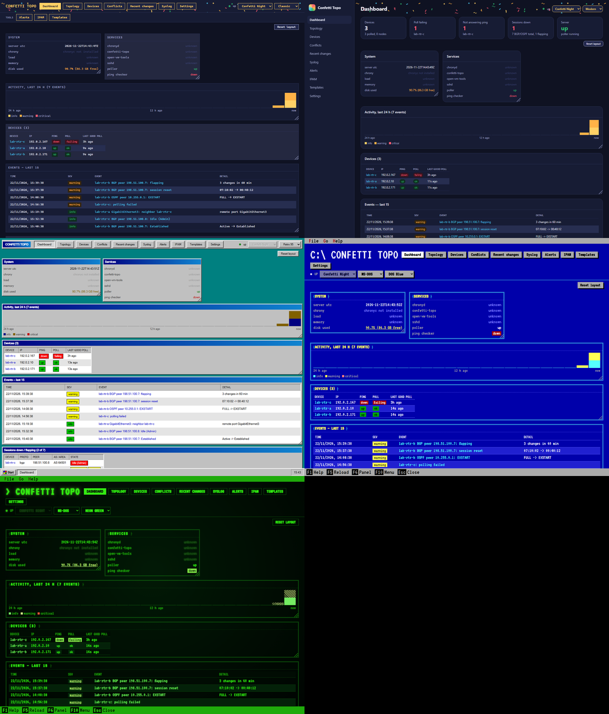

# confetti-topo

> **AI disclaimer:** This project was created using [Claude Code](https://claude.com/claude-code).

A small server that draws the network from what its routers say about themselves. It logs in to each
router over SSH (read-only `show` commands), or a Palo Alto firewall over the XML API (read-only `<show>`
operations), reads LLDP neighbors, BGP sessions and OSPF adjacencies, and shows them as one topology graph.
confetti-topo never writes to a device.

It also keeps the inventory around the map: IPAM, config templates a router can pull, running-config backups
with drift checks and syslog. Those came from the former confetti-butler project,
which was merged into this project; they are the IPAM and Templates pages (a second menu row in the
Classic layout, labelled Tools). The look follows the hub UI of the sibling project
[confetti-traffic](https://github.com/orneh24/confetti-traffic).



*Mock data from a made-up lab, using documentation-range addresses. See [Running locally](#running-locally).*

## What it does

- **Topology.** LLDP cables, BGP sessions and OSPF adjacencies on one graph, with per-protocol toggles and one to hide unknown (ghost) nodes, remembered in the browser.
  Devices are drawn as icons by type (router, switch, firewall, Linux server) with a Cisco, Palo Alto, Juniper or HPE mark; both can be switched off. A Lines dropdown makes the connector lines Small, Medium or Large.
  A cable or session that both routers report is drawn once. A neighbor that is not a known device shows
  as a dashed "ghost" node, so nothing is silently dropped. A BGP/OSPF session that is not Established /
  FULL is red and dashed, and a BGP session that keeps going down and up (flapping: 3 changes in an hour) is thick, yellow and dotted. A BGP session inside one AS (iBGP) is a thin yellow line and one between two ASes (eBGP)
  a thick purple line, and an "AS areas" toggle draws a box around the routers of each AS ("Tidy AS areas" moves the routers so each AS has its own block; a new map starts that way). A list of all known devices on the right selects a device on the map when clicked; its search box (name, IP or AS) fades the other devices. An LLDP cable is red and dashed when a device reports its port down. "Changed 24h" glows around devices that had a change in the last day, the Export menu saves the map as PNG or JSON, and the History dropdown shows the map as it was (snapshots kept `TOPO_SNAPSHOT_RETENTION_DAYS`, default 14). Unknown nodes that hang off one router are grouped into a single "N unknown"
  node (double-click to open it). The layout stands still and is saved on the server, so everyone sees the
  same map (the Re-arrange button, or right-click the background and choose Re-arrange, starts over after a confirmation). "Focus on device" (right-click a device, or the button on its card) makes it the master and lays the map out as a tree from it, in this browser only. The Layout dropdown also has "By site": each site in its own box, the best connected device of the site on top and one row per hop below it; these places are saved and can be dragged. A big map (more than 20 devices) opens By site with only LLDP and BGP shown; single links are straight lines, and zoomed out the small labels and vendor marks are left out. An LLDP link shows its ports
  on hover or when selected.
- **Peers find their router.** A BGP or OSPF peer is usually a loopback or link address, not the router's
  management IP. confetti-topo also reads each router's interface addresses, so a peer resolves to its
  router when exactly one router owns that address. Peers outside your lab stay ghosts. Two optional switches on
  the Settings page (off by default) also match an LLDP neighbor's chassis ID to a device's management MAC
  (PAN-OS reports it) or its system name to a hostname, for neighbors that advertise no known management IP.
- **Devices.** Add routers by hand, by a subnet sweep (SSH port scan), from a YAML seed file, or import the
  test nodes from confetti-traffic; an imported node is managed through its hub (no login, nothing sent to the node): its up/down state,
  build, subnet and the switch port it is plugged into (its own LLDP report) show on the map. The same router seen by two sources lands on one device. When the
  identifiers disagree (the same IP now answers with a different serial), it raises a conflict instead of
  guessing.
- **Templates, backups and drift.** A Jinja2 config template per device, rendered from what the router reports; the
  router pulls it with `copy http://<server>/configs/<key>.cfg running-config` (the server never pushes). Every
  changed running-config is kept as a version (secrets masked in the UI and API) with a diff, and the Template drift
  box and the Devices list show whether the router still contains its template.
- **IPAM.** Every interface address in one list, with overlapping prefixes and duplicate addresses flagged, used and free
  addresses per prefix, and one search box. The prefix table is one row per VRF and network, with the sites, a use bar,
  up / down status, an overlap / duplicate mark, a site filter and a CSV export.
- **Find.** The search box in the header finds a device, an IP (which interface holds it, and the route each router would use), a
  prefix, or a MAC (which device owns it, and the switch port that learned it).
- **Config backup search.** The Backups page lists the latest running-config of every device and searches all of them at once
  ("which routers have `ip ssh version 2`?", or the ones without it), secrets masked.
- **Polling.** Every few minutes it logs in once per router and reads version, interfaces (with error counters and their
  24-hour growth, and traffic in / out with a graph), LLDP, BGP, OSPF, routes and the running-config
  (switches also VLANs, trunks, spanning tree and the MAC table). A device can also be polled over SNMP v1/v2c
  (platform `snmp`: version and interfaces only). Anything a router stops reporting drops out. A failed poll (timeout, bad login) removes nothing.
  Platforms: Cisco IOS / IOS-XE (SSH) and Palo Alto PAN-OS (XML API, set the device's platform to
  `paloalto_panos`; the same username and password as for SSH).
- **Crawl.** LLDP neighbors that advertise an unknown management IP are listed on the Devices page and can be
  added as inventory-only devices (polling stays off until you set a login and enable them).
- **Reachability.** Every device is pinged every 30 seconds; a router that stops answering is outlined red
  on the graph.
- **Events.** Neighbor, peer and interface changes, OS changes and devices going unreachable are listed on the
  dashboard, on each device page and on the Recent changes page (filters, sortable, Before and After states coloured green, yellow or red, a "flapping" mark on anything that changed 3 times within an hour (set on the Settings page), resizable columns). Every table's columns can be resized by dragging a header's edge (double-click to reset), and right-clicking a table offers "Resize (compact)", which shrinks every column to its content.
- **Device page.** A status strip at the top (ping, poll, sessions, drift, errors, ports down), a Test login button, interfaces, LLDP neighbors, BGP/OSPF sessions and the routing table (filter, "export CSV"). On a switch also VLANs, trunks, the spanning-tree summary and the learned MAC addresses (filter; a MAC that belongs to a known device names it).
- **Map notes.** A note on any node or link (circuit ID, provider, ticket), shown in its card and in the JSON export.
- **Metrics.** `GET /metrics` serves Prometheus text.
- **Confetti Traffic.** One Settings panel holds the Traffic URL (a small button for it appears at the right of the top menu and opens in a new tab), an Import nodes block (Import now, optional re-import every 5-1440 minutes) and the syslog pull from it.
- **Dashboard.** Widgets: System, Services, Activity, Devices, Events, Sessions down, Open conflicts, Unknown LLDP neighbors (with an add button) and Map changes (each row opens that snapshot on the map). Drag a widget by its title to move it (a copy follows the pointer and a grid outline shows where it will land; drop it on the middle of another widget to put them side by side, sharing the row, or into the empty space at the end of a row), drag its corner to resize it; the arrangement is kept in the browser, "Reset layout" undoes it and "Auto sort layout" rearranges the widgets to leave as little empty space as it can. "Lock layout" keeps them where they are (no moving, resizing or automatic sorting) until it is unlocked. The Devices widget shows IP, vendor, model, OS version, ping and poll state; click a heading to sort and use Columns to add or remove columns (also role, site, platform, serial).
- **Look.** Seven colour themes (or Shuffle) and four layouts (MS-DOS in two colour variants), picked in the header.







The MS-DOS layout can be driven from the keyboard: F10 or Alt for the menu bar, Up/Down and Enter on table
rows, F6 between panels, F1 for the list.

Built for Cisco IOS / IOS-XE. The parsers were checked against CSR1000v
routers on IOS-XE 17.3 and 15.4; the merged confetti-topo has not been run on real routers yet (see
[`docs/HANDOFF.md`](docs/HANDOFF.md)). The PAN-OS support was written from real output of a PA-VM on PAN-OS 11.1 and
polled once against it; other PAN-OS versions, Panorama and several virtual routers are untested.

## Running locally

Needs Python 3 and `pip install -r topo/requirements.txt`. Port 80 needs admin rights, so pick another:

```sh
cd topo
TOPO_PORT=8080 python serve.py
```

Open http://localhost:8080 and add a device on the Devices page. Set the SSH login for all devices on the
Settings page (or for one device on its page, under Credentials), then click **Poll now** (Devices page or device page) or **Poll all now**. The database is `topo.db` in the working folder. To ask for a token before anything is shown, start it with `TOPO_AUTH_TOKEN=<secret>` (a login page for browsers, `Authorization: Bearer <secret>` for scripts and Prometheus; `/api/health` stays open). It is one shared token, not user accounts, and it needs HTTPS in front of it to be safe on an untrusted network.

To look around without a router, fill a new database with a fake lab:

```sh
python scripts/seed_mock_lab.py mock.db
TOPO_DB_PATH=mock.db TOPO_PORT=8080 TOPO_PING_ENABLED=false python serve.py
```

## Deploying

`topo/build-topo.sh` installs confetti-topo on a fresh Alpine Linux VM (OpenRC service, waitress, port 80), following the
same pattern as confetti-traffic's hub.

**System requirements:** Alpine Linux 3.x, 256 MB RAM minimum, 512 MB recommended.

- **Update a running VM:** `topo-update.sh` (no arguments: downloads the latest build from GitHub; a `<topo-dir|tarball>` argument updates from that instead and asks first without `-y`) installs the new code and packages
  (`build-topo.sh --update`), checks it, backs up the database,
  swaps it in, and rolls back by itself if it does not come up. `--rollback` goes back one version.
- **Backups:** nightly (7 kept) to `/var/lib/confetti-topo/backups`. The Settings page (Backup and restore) downloads a backup and the
  settings (without secrets) and restores an uploaded one; on the VM `topo-db.sh backup|list|env|restore` does the same, for example to move
  to a new VM. A restore saves the current database first.
- **Container:** `container/` has a Dockerfile and compose file for trying it without ESXi:
  `docker compose -f container/docker-compose.yml up --build`. For development,
  `container/docker-compose.dev.yml` mounts `topo/` live: `--profile mock` (fake lab, port 8080) or
  `--profile lab` (empty DB for real routers, port 8081).

## Security notes

- Credentials are stored in plain text in `topo.db`, and so in every backup of it. Keep the files private; both are gitignored.
- The web UI and API have no login unless `TOPO_AUTH_TOKEN` is set. Run it on a lab network only. A sweep range or a confetti-traffic URL
  given to the API makes the server connect there.

## More

- [`CLAUDE.md`](CLAUDE.md): architecture and the rules not to break
- [`docs/TOPOLOGY-MAPPING.md`](docs/TOPOLOGY-MAPPING.md): how the mapping works, pitfalls, a test checklist
- [`docs/HANDOFF.md`](docs/HANDOFF.md): build history, and what is and isn't verified
- [`docs/ROADMAP.md`](docs/ROADMAP.md): what could come next
